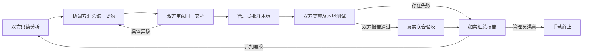

# 协作执行架构升级

平台保持单服务与 MySQL。智能分析、契约协商、代码实施和测试由项目本地 Agent 完成；平台负责版本、调度、权限、审批及证据归档。管理员仍只需提交目标、审阅并批准文档，以及最终审阅报告或追加要求。

## 生命周期



对应阶段为 `planning → plan_synthesis → plan_confirmation → awaiting_approval → executing → joint_verifying → awaiting_review → terminated`。暂停是独立控制状态，不改变所处开发阶段，不自动撤销已写文件。

## 1. 单一共同契约

双方首先用 `plan.submit` 提交本地项目分析。收齐后仅向协调方派发 `plan.compose`。协调方为本轮指定参与方中的第一方，平台按稳定顺序选定。

协调方 Agent 提交完整 `contract`，包含：

- `scope`：目标、范围和实施方式。
- `interfaces`：具有稳定 ID 的完整接口语义，包括请求、响应、校验与错误约定。
- `responsibilities`：每个项目的改动、实施步骤和职责。
- `acceptanceCases`：稳定用例 ID、执行项目、真实联测命令、说明和预期结果。
- `risks`：依赖、运行条件和限制。
- `changeSummary`、`impactedParticipantIds`、`retainedDecisions`：本轮变化及复用决定。

平台校验参与方归属、ID 唯一性、项目责任覆盖和联测覆盖，再确定性渲染一份完整文档。双方原始分析保留用于追溯，不再直接拼接成最终契约。

每方独立审阅后使用 `plan.confirm` 确认当前 revision/hash。`plan.reject` 必须指明当前文档及具体原因；它作废双方确认，返回协调方修订。已有异议的同一份原文不能直接重新提交。平台校验结构与版本，接口语义是否正确仍由双方 Agent 审阅和真实用例验证。

审阅还须核对验收命令与实际脚本的断言是否一致。缺少覆盖时，应在计划中明确获批后的补齐责任，或提出异议返回修订；不能只登记风险后确认，再以命令退出码 0 代替未运行的用例。

双方确认同一份文档后才进入管理员批准阶段。AI 无法代替管理员批准；任何修订均不继承旧批准。

## 2. 内建联合验收

`execution.report` 只记录本方实施及本地测试。双方均报告通过后，平台自动派发 `joint_verifying`，由每方执行自己负责的已批准用例并提交 `integration.report`。

结果必须覆盖本方所有用例，不能使用其他方用例替代或遗漏。每项分别记录 `passed`、`failed` 或 `not_run`；已执行项必须有实际命令和证据。Connector 追加实际代码及工作区指纹，以便关联本轮结果。

双方实施存在失败时，报告明确标注联合验证未执行。联测失败或未执行也会生成如实报告供管理员审阅，不会形成“全部联调通过”的结论。报告收齐不等于管理员已接受；最终仍须人工决定追加要求或终止。

平台不直接执行契约里的 shell 文本。命令由本机 Agent 核对后，在本地能力和批准范围内运行。Codex 的写入及网络策略在获批的 `executing` / `joint_verifying` 阶段生效；规划和未批准阶段保持只读。

## 3. 持久化恢复与停止

Connector 在本地记录任务开始、执行结果和待发送回执。结果先写入临时文件，再原子替换日志文件；只有平台确认后才标记 `acknowledged`。网络异常留下 `pending`，重启后先重发，再领取新任务。永久拒绝保存为 `rejected`，供本机排查。

服务端用规范化回执指纹识别同一领取轮次的相同回传。首次动作和完成状态在同一事务提交；相同回执只返回确认，不再次应用动作。不同回执、旧领取轮次或失效租约仍被拒绝。

`workflow_wakeups` 与实施结果或管理员状态变更一同写入事务。Connector 心跳和轮询会扫描当前协作的未完成调度记录，派发失败保留原因并退避重试。重复处理由协作事务锁和已有任务合并控制。此机制不依赖进程内队列；服务重启后待调度意图仍在 MySQL 中。

长任务心跳携带任务 ID 和领取轮次，续期当前租约。过期租约不能被旧执行端复活。Connector 在租约失效或平台要求取消时停止本地执行。管理员可点击“暂停自动协作”，平台取消待领及在途任务，执行端停止后回传确认时间；恢复会重新派发当前未完成阶段。

Codex 使用已有 App Server `turn/interrupt` 通道停止本次 turn。官方协议说明见 [OpenAI Docs：Codex App Server](https://learn.chatgpt.com/docs/app-server)。暂停为协作停止请求，不能撤销已经产生的文件修改，也不能保证每种外部工具都已撤销所有外部副作用。

进程在执行中崩溃、尚未保存结果时，日志会保留 `running`。Connector 不盲目重跑这个任务，而是报告完成状态未知；后续任务须检查已有文件和测试现状。任意代码或外部操作无法由消息幂等机制保证绝对只执行一次。

## 4. 项目工作区隔离

默认采用同一项目工作区写入排队，保留当前工作目录及已有未提交修改。锁的范围提升到本机同一 Git 工作树；不同协作、线程或 Connector 共用队列。非 Git 项目按规范化目录排队，符号链接指向同一目录时不会产生独立锁。

队列等待支持取消；本次任务结束仅清理本次锁。独立 Git worktree 可以并行执行，合并和分支管理继续由项目维护者决定。

Git 可用时记录 HEAD、已跟踪改动及未跟踪文件的内容指纹。计划提交时带上基线；实施前发现基线变化或无法重新读取已记录的基线，会在调用 Agent 前报告阻塞，要求核对并重新批准。本轮回执追加执行前后工作区指纹。指纹不上传源码内容。

工作区队列约束使用同一锁目录的 Seam Connector，不能阻止人工编辑或不使用此队列的外部程序。Git 基线采集不可用时返回明确空值，不能据此声称代码版本已经核验。

## 5. 增量协商

追加要求单独记录为 `changeRequest`，保留上版契约、文档指纹和报告供双方复用。Agent 分析本轮影响，协调方生成包含未变内容的完整新契约，而不是让管理员重填资料。

平台展示本轮要求、Agent 变更说明、影响项目和保留决定；完整文档还列出接口、职责、用例的实际增删改。历史结果只作参考，不自动填充新版通过状态。双方确认和管理员批准仍绑定完整新版内容。

## 部署与本地配置

服务端运行迁移 `0003_quick_ultimates.sql`，新增调度恢复表、契约、联测、基线和停止确认字段，保留历史记录。已有形成文档的旧版任务可继续按原有文档审阅，不能将其历史报告补称为已完成新式联合验收；新一轮计划使用统一契约流程。

重建并重启每端 Connector 后使用新增能力：

```bash
pnpm --filter @seam/connector... build
node --env-file=/path/to/private/seam.env apps/connector/dist/cli.js --adapter codex-app-server
```

可选维护配置：

| 环境变量 | 参数 | 默认值与用途 |
| --- | --- | --- |
| `SEAM_CONNECTOR_STATE_DIR` | `--connector-state-dir` | `~/.seam/connectors`，按平台、Agent、项目隔离执行日志及待发回执 |
| `SEAM_WORKSPACE_LOCK_DIR` | `--workspace-lock-dir` | `~/.seam/workspace-locks`，同机访问相同工作区的 Connector 须共用此位置 |
| `SEAM_APP_SERVER_STATE_DIR` | `--app-server-state-dir` | 延续原配置，保存本地 Codex thread 映射 |

这些是本机维护配置，不增加管理员创建对接任务时的表单。执行日志包含协作结果，应存放在本机私有目录；Connector Token 不写入执行日志。

服务端和 Connector 应一起升级。旧客户端无法处理新增的契约汇总与联合验收动作。回退应用前需要先停止新式任务并检查数据库兼容性，不能删除已执行任务的记录来冒充未执行。

## 验证入口

```bash
pnpm typecheck
pnpm lint
pnpm test
pnpm simulation:up
pnpm test:lifecycle
pnpm test:simulation
pnpm test:simulation:fixtures
pnpm test:simulation:cancel
```

浏览器验收沿用项目 Playwright 测试，覆盖两轮协商、审批、联合验收、暂停恢复及手动终止。本机 Mac 启动测试浏览器须遵循本机沙箱外执行规则。

真实端模拟使用真实 Codex App Server 与明确标注的虚拟提供方。网关由测试基础设施提供，报价及消费业务实现由各端在批准后完成；本地合成验证不代表业务项目上线或生产验收。
