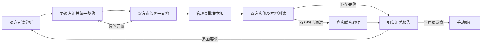

# 协作执行架构升级

平台保持单服务与 MySQL。智能分析、契约协商、代码实施和测试由项目本地 Agent 完成；平台负责版本、调度、权限、审批及证据归档。管理员仍只需提交目标、审阅并批准文档，以及最终审阅报告或追加要求。

任务交付与执行分开：领取时只有60秒交付租约，Connector先确认当前attempt才开始本地工作并续为20分钟执行租约。正常轮询立即返回并在本机按pollMs等待；兼容长轮询会响应断连并按领取轮次释放。这样空闲Connector重启时，旧连接不能把下一任务长期占为运行中。丢失的交付在一分钟后可由当前worker重领，旧attempt的续租及回执均被拒绝。

## 生命周期



对应阶段为 `planning → plan_synthesis → plan_confirmation → awaiting_approval → executing → joint_verifying → awaiting_review → terminated`。暂停是独立控制状态，不改变所处开发阶段，不自动撤销已写文件。

## 1. 单一共同契约

双方首先用 `plan.submit` 提交本地项目分析。收齐后仅向协调方派发 `plan.compose`。协调方为本轮指定参与方中的第一方，平台按稳定顺序选定。

协调方 Agent 提交完整 `contract`，包含：

- `scope`：目标、范围和实施方式。
- `interfaces`：具有稳定 ID 的完整接口语义，包括请求、响应、校验与错误约定。
- `responsibilities`：每个项目的改动、实施步骤和职责。
- `acceptanceCases`：稳定用例 ID、执行项目、真实联测命令、说明和预期结果。
- `risks`：依赖、运行条件和限制。
- `changeSummary`、`impactedParticipantIds`、`retainedDecisions`：本轮变化及复用决定。

平台校验参与方归属、ID 唯一性、项目责任覆盖和联测覆盖，再确定性渲染一份完整文档。双方原始分析保留用于追溯，不再直接拼接成最终契约。

每方独立审阅后使用 `plan.confirm` 确认当前 revision/hash。`plan.reject` 必须指明当前文档及具体原因；它作废双方确认，返回协调方修订。已有异议的同一份原文不能直接重新提交。平台校验结构与版本，接口语义是否正确仍由双方 Agent 审阅和真实用例验证。

独立 Connector 并发审阅时，一方提出异议或更新计划会在同一事务内取消其他方的旧只读审阅任务。心跳通知本地中断，再派发最新文档；迟到确认不作为实施失败，也不能恢复旧确认。

审阅还须核对验收命令与实际脚本的断言是否一致。缺少覆盖时，应在计划中明确获批后的补齐责任，或提出异议返回修订；不能只登记风险后确认，再以命令退出码 0 代替未运行的用例。

双方确认同一份文档后才进入管理员批准阶段。AI 无法代替管理员批准；任何修订均不继承旧批准。

## 2. 内建联合验收

`execution.report` 只记录本方实施及本地测试。双方均报告通过后，平台自动派发 `joint_verifying`，由每方执行自己负责的已批准用例并提交 `integration.report`。

结果必须覆盖本方所有用例，不能使用其他方用例替代或遗漏。每项分别记录 `passed`、`failed` 或 `not_run`；已执行项必须有实际命令和证据。Connector 追加实际代码及工作区指纹，以便关联本轮结果。

双方实施存在失败时，报告明确标注联合验证未执行。联测失败或未执行也会生成如实报告供管理员审阅，不会形成“全部联调通过”的结论。报告收齐不等于管理员已接受；最终仍须人工决定追加要求或终止。

平台不直接执行契约里的 shell 文本。命令由本机 Agent 核对后，在本地能力和批准范围内运行。Codex 的写入及网络策略在获批的 `executing` / `joint_verifying` 阶段生效；规划和未批准阶段保持只读。

## 3. 持久化恢复与停止

Connector 在本地记录任务开始、执行结果和待发送回执。结果先写入临时文件，再原子替换日志文件；只有平台确认后才标记 `acknowledged`。网络异常留下 `pending`，重启后先重发，再领取新任务。永久拒绝保存为 `rejected`，供本机排查。

服务端用规范化回执指纹识别同一领取轮次的相同回传。首次动作和完成状态在同一事务提交；相同回执只返回确认，不再次应用动作。不同回执、旧领取轮次或失效租约仍被拒绝。

`workflow_wakeups` 与实施结果或管理员状态变更一同写入事务。Connector 心跳和轮询会扫描当前协作的未完成调度记录，派发失败保留原因并退避重试。重复处理由协作事务锁和已有任务合并控制。此机制不依赖进程内队列；服务重启后待调度意图仍在 MySQL 中。

长任务心跳携带任务 ID 和领取轮次，续期当前租约。过期租约不能被旧执行端复活。Connector 在租约失效或平台要求取消时停止本地执行。管理员可点击“暂停自动协作”，平台取消待领及在途任务，执行端停止后先在本机独立持久化停止回执，再经心跳发送；收到明确确认才移出待发队列，网络丢失时重启会先重发。旧任务或领取轮次明确标记拒绝。恢复会重新派发当前未完成阶段。重复停止确认保留首次停止时间。

Codex 使用已有 App Server `turn/interrupt` 通道停止本次 turn。官方协议说明见 [OpenAI Docs：Codex App Server](https://learn.chatgpt.com/docs/app-server)。暂停为协作停止请求，不能撤销已经产生的文件修改，也不能保证每种外部工具都已撤销所有外部副作用。

进程在执行中崩溃、尚未保存结果时，日志会保留 `running`。Connector 不盲目重跑这个任务，而是报告完成状态未知；后续任务须检查已有文件和测试现状。任意代码或外部操作无法由消息幂等机制保证绝对只执行一次。

## 4. 项目工作区隔离

默认采用同一项目工作区写入排队，保留当前工作目录及已有未提交修改。锁的范围提升到本机同一 Git 工作树；不同协作、线程或 Connector 共用队列。非 Git 项目按规范化目录排队，符号链接指向同一目录时不会产生独立锁。

队列等待支持取消；本次任务结束仅清理本次锁。独立 Git worktree 可以并行执行，合并和分支管理继续由项目维护者决定。

Git 可用时记录 HEAD、已跟踪改动及未跟踪文件的内容指纹。指纹 v2 使用有边界的序列化清单，包含路径、文件类型、权限和内容散列；符号链接只记录链接目标，不跟随读取。不同文件集合不能因文件名和内容直接拼接而产生相同编码；同一仓库的子目录采用统一根目录视图。计划提交时带上基线；实施前发现外部基线变化或无法重新读取已记录的基线，会在调用 Agent 前报告阻塞，要求核对并重新批准。

获批实施前在本机记录 revision、approvedHash、批准基线、当前工作区和运行状态。正常停止或明确阻塞后，在工作区锁内保存 recoverable 检查点。只有同版同批准、批准基线一致、当前文件与停止时完全一致才允许续接合法部分修改；Agent 必须检查现状，只继续剩余工作。外部修改、其他批准或修订、无法读取的指纹及崩溃后仍为 running 的未知状态不能借此通过。旧指纹算法生成的未完成任务需重新规划，不自动迁移为已核验。

本轮回执追加执行前后工作区指纹。指纹不上传源码内容。

工作区队列约束使用同一锁目录的 Seam Connector，不能阻止人工编辑或不使用此队列的外部程序。Git 基线采集不可用时返回明确空值，不能据此声称代码版本已经核验。

## 5. 增量协商

追加要求单独记录为 `changeRequest`，新版requirements只存本轮请求，保留上版契约、文档指纹和报告供双方复用。共同文档以effectiveRequirements稳定ID列出有效要求，移除上版ID必须在retiredRequirements声明原因，防止旧约束与新要求混用。Agent 分析本轮影响，协调方生成包含未变内容的完整新契约，而不是让管理员重填资料。

平台首先展示范围、实施结论、用例状态、证据关联数量、Agent 变更说明和影响项目；按稳定 ID 比较实际内容，展开上版和本版的接口、职责及用例差异。同 ID 内容变化也显示。完整文档、报告、历史及命令原始输出可按需展开。历史结果只作参考，不自动填充新版通过状态。双方确认和管理员批准仍绑定完整新版内容。

## 6. 按需资料读取

原生交接协议 v4 每轮保留阶段、审批及本机权限，原始目标、有效要求和用户指示仅在变化时交接；长文档、前版契约、报告及命令输出落入本机私有、内容寻址的资源文件。正文仅列路径、SHA-256、字节数及确定性状态概览，完整原文不截断。确认或首次实施本版前，Agent 读取完整共同文档；其他资料按需读取。资源内容不符时停止调用，避免引用被改写的事实。

同一成功会话只发送变化的资源引用，新会话、压缩或无效检查点恢复完整引用。原生回复 schema 仍走 `turn/start.outputSchema`；通用 CLI 通过本机文件读取回复协议和完整机器上下文，命令参数不再包含全部 JSON。原生 schema 使用接口支持的格式子集，URL 在本地解析和健康探测处校验。

文件读取及会话历史仍有模型成本。交接正文变短不等于 token、耗时或费用按相同比例下降。

## 7. 结构化阻塞与就绪交接

`workflow.blocked` 明确区分 `waiting_peer`、`retryable` 和 `needs_admin`。等待对端通过参与方 ID 记录依赖，未出现计划或有效服务时不反复唤起模型；临时故障按 retryAt 延迟调度，连续第三次转为需管理员处理。双方循环等待会形成明确阻塞。`needsHumanInput=true` 的旧式回复也转换为需管理员补充事实，不误判为已完成成果。管理员只补充真正缺失的事实后继续；改变目标仍走追加要求、新版确认与批准。

每轮提交一项主要成果或阻塞，服务发布可附加。模型同时返回全部 `not_run` 的联合说明和明确等待时，原始回执完整保留，只应用等待，避免提前生成最终报告；实际执行的成功或失败不会被此归并丢弃。没有阶段成果的空动作回复转为有界临时重试。

`service.publish` 仅在当前版获批实施或联合验证阶段使用。本地 Connector 对同源健康地址实际发 HTTP 请求，按共同文档serviceExpectations核验状态码及bodyChecks字段（如ready=true、revision=当前版），成功后补充探测时间、批准文档和就绪契约指纹，再交给平台保存带TTL的服务地址。字段缺失、类型不符、旧版或非JSON响应均不作为该语义探测通过。禁止凭据 URL 和跨源健康地址；暂不可达或非成功响应如实进入退避。平台不访问项目网络，不执行远端 shell，也不把尚未就绪或过期服务交给对端。项目 Agent 负责启动、维护和关闭自己创建的服务。

## 8. 命令证据与用例关联

真实 Codex 的 `commandExecution` 完成事件由 Connector 采集；通用端可由本机维护者配置 `SEAM_TEST_COMMAND` 供 Connector 独立运行。平台契约里的命令文本不能成为 Connector 执行任意命令的授权。采集仅发布可识别的测试/检查命令输出，不把源码读取命令 stdout 当证据；上传前移除常见密钥及本地项目路径。

联合结果提供 `assertionNames`，Connector 依据本轮实际输出分配 `runIds`，不接受模型自造引用。新共同文档为每项声明完整requiredAssertions；通过项必须完整报告并实际通过这些必需断言，同时匹配本方已批准命令及退出码0。仅健康检查或断言子集不能替代整项验收。服务端再次核对归属、断言、命令和退出码。原始日志以运行 ID 集中保存，多个用例引用同一份，不逐项复制；UI 分开显示命令证据和用例解释。日志过大明确标记上传边界。

动态地址和修订可通过 `SEAM_SERVICE_URL`、`SEAM_REVISION` 绑定到已批准命令，实际调用原文保留在 `invocation`；不能把任意环境参数、命令替换或组合命令视为同一用例。跳过、TODO 和未完成断言不作为通过断言。

旧客户端没有自动采集引用的报告仍可读取，但标注“Agent回报，未关联自动采集的断言记录”，不能改称自动验证。测试名称关联并不自动证明全部业务语义，仍需双方 Agent 检查实际断言和管理员审阅报告。

## 部署与本地配置

服务端先运行 `0003_quick_ultimates.sql`，再运行 `0004_overjoyed_firestar.sql`。后者在贡献记录中增加 block、services、evidence_runs，保存阻塞、服务就绪及去重的命令记录，保留历史数据。已有形成文档的旧版任务可继续按原有文档审阅，不能将其历史报告补称为已完成新式联合验收；新一轮计划使用统一契约流程。

重建并重启每端 Connector 后使用新增能力：

```bash
pnpm --filter @seam/connector... build
node --env-file=/path/to/private/seam.env apps/connector/dist/cli.js --adapter codex-app-server
```

可选维护配置：

| 环境变量 | 参数 | 默认值与用途 |
| --- | --- | --- |
| `SEAM_CONNECTOR_STATE_DIR` | `--connector-state-dir` | `~/.seam/connectors`，按平台、Agent、项目隔离执行日志及待发回执 |
| `SEAM_WORKSPACE_LOCK_DIR` | `--workspace-lock-dir` | `~/.seam/workspace-locks`，同机访问相同工作区的 Connector 须共用此位置 |
| `SEAM_HANDOFF_RESOURCE_DIR` | 无 | 通用 CLI 的私有资源目录；优先此值，否则使用 Connector 状态目录下 resources，未配置时为 `~/.seam/resources` |
| `SEAM_APP_SERVER_STATE_DIR` | `--app-server-state-dir` | 延续原配置，保存本地 Codex thread 映射 |

这些是本机维护配置，不增加管理员创建对接任务时的表单。执行日志包含协作结果，应存放在本机私有目录；Connector Token 不写入执行日志。

服务端和 Connector 应一起升级。旧客户端无法处理新增的契约汇总与联合验收动作。回退应用前需要先停止新式任务并检查数据库兼容性，不能删除已执行任务的记录来冒充未执行。

## 验证入口

```bash
pnpm typecheck
pnpm lint
pnpm test
pnpm simulation:up
pnpm test:lifecycle
pnpm test:simulation
pnpm test:simulation:fixtures
pnpm test:simulation:cancel
pnpm test:simulation:recovery
```

浏览器验收沿用项目 Playwright 测试，覆盖两轮协商、审批、联合验收、暂停恢复及手动终止。本机 Mac 启动测试浏览器须遵循本机沙箱外执行规则。

真实端模拟使用真实 Codex App Server 与明确标注的虚拟提供方。主流程运行两个独立、持续轮询的 Connector 进程，不安排提供方先执行。初始项目只有 README、AGENTS 和 Git 基线，没有 HTTP 网关、实现或联合脚本。虚拟提供方获批后实施并启动真实服务，延迟就绪并通过 service.publish 发布，消费方真实 Codex 独立实施客户端及联合脚本。虚拟端还实际审阅契约并针对缺失的健康与修订语义提出异议。单独 recovery 测试以显式合成协商夹具批准真实 Codex 的长命令，注入丢失停止确认，再验证同版恢复且长命令只启动一次。本地合成验证不代表业务项目上线、两个真实模型或生产验收。

## 对话标识与观察用量

本机Codex会话标题使用短任务名、项目名和当前修订；SEAM_RUN_LABEL是本机配置的可选测试批次标签，不由远端文本改变。新增修订更新标题但沿用同一thread。任务页面集中列出最近20条执行记录中的会话及观察指标，去重同一turn的用量，明确未知和累计值，不把多次累计值相加。模拟运行另输出run-index.json记录本次批次、任务状态及会话链接，失败与恢复专项各自保留索引。
