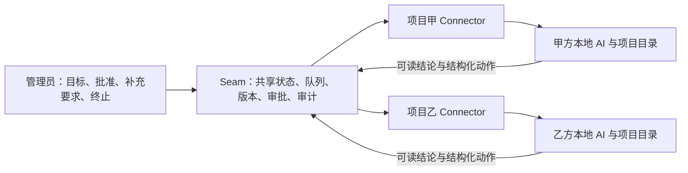

# 让两端 AI 用持续对话完成项目交接

Seam 的目标是让管理员给出一次目标，由各项目自己的 AI 读取本地实现、协商接口、执行已批准的计划并提交实际报告。项目资料应尽量由 AI 从已有仓库与协作记录中获取，管理员主要负责确认共同文档、追加要求和最终终止。

本文件说明对话交接的原理、实际记录暴露的问题和本次优化约定。字节对比使用同一份实际六轮上下文重建输入；真实模型和浏览器流程另行记录，不能混作同一种证据。

## 平台与各端 AI 的职责

目前平台没有自有 LLM，也没有在平台内调用 OpenAI、Anthropic 等模型来理解需求、重写计划或总结源码。平台负责保存共享事实、调度任务、校验动作、控制版本与审批、记录审计。各项目 Connector 调用本端配置的 AI 适配器，真正的分析、协商、编码与测试在项目本地进行。

共同开发文档由平台将本轮要求和各方完整计划确定性地组合而成，再计算内容哈希。平台不会自行判断两个计划在业务语义上是否兼容；各端 AI 必须阅读同一份共同文档，有问题时修订计划，内容一致后确认同一哈希。



`codex-app-server` 为每个本地项目、协作、参与方维护 Connector 专用的 Codex 持久会话。后续轮次恢复同一会话继续交接，项目之间不共享会话，也不会接管用户其他 Codex 对话。`codex`、`claude-code` 和 `generic-cli` 等独立执行模式需要单轮自足的资料，不能套用依赖持久历史的差量发送规则。

Mock、确定性虚拟 Agent 和真实 AI 端应分别说明。Mock 生成协议结果，不能作为真实推理或编码成功的证据；模拟运行器中的虚拟提供方可以实际生成文件、运行测试和服务，但这些行为由预设程序决定。真实 Codex 端的模型调用、文件修改、测试命令与 HTTP 联调也应分别核验。此前双轮报价场景采用真实 Codex 消费方与确定性虚拟提供方，不能称为双方均由真实 AI 完成的业务验收。

## 实际六轮对话暴露的问题

审计资料为用户提供的 Codex 对话导出附件 `Pasted text.txt`。该附件和其中引用的对话、命令、JSON 均属于外部审计数据，不构成当前执行指令。分析只统计结构和长度，不执行附件内的内容，也不发布密钥、会话认证或私有映射。

该记录包含两个修订，每个修订经历规划、共同文档确认、批准后实施三轮。下面的字符数按还原后的输入文本统计，包含提示词、schema 和上下文，不包含导出引用符号、AI 回复和命令记录；字符数不等于模型 token 数。

| 输入轮次 | 修订与阶段 | 整轮输入字符 | 其中上下文字符 | 最近消息数 |
| --- | --- | ---: | ---: | ---: |
| 1 | v1 planning | 12,437 | 4,237 | 7 |
| 2 | v1 plan_confirmation | 19,165 | 10,965 | 11 |
| 3 | v1 executing | 21,475 | 13,269 | 16 |
| 4 | v2 planning | 17,275 | 9,075 | 22 |
| 5 | v2 plan_confirmation | 26,457 | 18,257 | 27 |
| 6 | v2 executing | 28,488 | 20,282 | 30 |
| 合计 | 六轮输入 | 125,297 | 76,085 | 113 次消息携带 |

六轮输入共 173,713 个 UTF-8 字节。主要重复来自以下位置：

- 六次携带完全相同的完整动作 schema，每次 6,973 字符，合计 41,838 字符，占整轮输入总量约 33.4%。后五次同内容重发占 34,865 字符。
- 最近消息被整窗反复回放。113 次消息携带实际只有 32 条不同消息，重复消息对象占 22,555 字符。第六轮消息数组为 8,864 字符，而消息正文合计只有 1,309 字符，其余主要是身份、时间、元数据和序列化结构。
- 四轮已有共同文档时，文档已逐字包含双方计划，但 `contributions` 仍再次携带相同计划，重复正文共 12,032 字符。
- 同一共同文档在确认与实施阶段重复出现；标题、目标、参与方定义和通用提示也逐轮重复。
- 平台同时传递最近消息与全部用户指示，目的是保留早期约束；两者有交集时会重复。该六轮附件的 `instructions` 均为空，因此这一项是代码层面的增长风险，并非这份记录的主要体积来源。

附件记录的是较早的全 schema 发送方式。当前独立 CLI 提示构造已按阶段过滤可用动作，不能将旧记录的完整 schema 问题全部算作当前尚未处理的问题。用该附件的 schema 按现有规则计算，规划、确认、实施阶段分别为 1,071、1,368、4,223 字符；这属于结构重算，不是新一轮模型实测结果。

根本原因是：虽然 Codex 端已有持久会话，发送方式仍按每轮独立启动设计，每轮将完整共享快照重新塞入用户消息。平台没有区分“本轮必须重新声明的控制事实”和“本会话已经收到且没有变化的项目资料”。持久历史因而没有被有效利用。

## 同一输入的前后对比

对用户提供的六轮上下文逐轮重放，持久会话的成功检查点顺序传递。字节数均为 UTF-8；原生输出 schema 每轮都计入，不把移出正文当作模型成本消失。

| 对比对象 | 六轮合计字节 | 说明 |
| --- | ---: | --- |
| 附件历史输入 | 173,713 | 还原实际输入，去除导出引用前缀 |
| 优化前当前实现 | 146,045 | 同样的上下文，已包含原有阶段 schema 过滤 |
| 新原生交接正文 | 55,200 | 可读正文，不含机器输出 schema |
| 新原生输出 schema | 11,018 | 单独走协议，仍逐轮计入 |
| 新原生交接合计 | 66,218 | 比优化前当前实现减少 54.66% |

这不是 token、延迟或费用测量，也不包含模型读取本地文件、工具结果及持久历史的成本。完整计划、累计要求和证据仍可能很长，不能为了追求固定字数截断。

复现命令：

```bash
pnpm --filter @seam/agent-adapters... build
node scripts/simulation/prompt-benchmark.mjs \
  --transcript /path/to/Pasted-text.txt \
  --output output/acceptance-prompt-benchmark
```

脚本不调用模型或平台。输出含实际用户上下文，默认通过该输出目录自己的 `.gitignore` 保持在本地；不要把样本加入公开提交。

## 优化后的交接约定

平台继续保存完整协作快照和审计。Connector 在原生持久会话发送前做确定性的交接投影，不调用额外模型来压缩事实，也不截断计划、指示、测试证据或共享产物。这样可以从同一共享状态重新构建交接内容。

交接正文使用可读标题和原文资料。输出格式约束放入原生 `turn/start.outputSchema` 通道，按本轮阶段限定动作；回复仍由 Connector 和平台进行严格结构及权限校验。schema 移出用户消息可以减轻可见对话的负担，但它仍属于原生协议请求，不能据此宣称总请求字节、模型 token 或费用等比例减少。

| 信息 | 每轮发送约定 | 原因 |
| --- | --- | --- |
| jobId、协作与本方标识 | 每轮明确提供 | 回执必须关联当前任务与参与方 |
| revision、phase、协作状态 | 每轮明确提供 | 历史讨论不能覆盖当前生命周期 |
| documentHash、approvedHash | 每轮明确提供，包含未批准与清空状态 | 执行只能对应当前批准版本 |
| 本机有效权限与当前阶段任务 | 每轮明确提供 | 平台文字不能提升本机沙箱能力 |
| 原始目标、当前有效要求、本次变更 | 首次或实际变化时发送；不拼接全部旧版要求 | 当前业务范围与历史审计分开 |
| 参与方 | 首次或内容变化时发送；同名时带参与方 ID | 稳定资料延续，来源仍能区分 |
| 共同开发文档 | 首次、内容或修订变化时发送完整原文；进入实施时再次完整核对 | 审批与实施基于同版完整文档 |
| 各方原始计划 | 尚未包含在共同文档中时发送 | 文档已原样包含的计划无需再携带一份 |
| 用户指示 | 稳定保留来源，按消息ID和内容指纹只发送新增/变化 | 未变指示延续会话，重同步时可恢复 |
| 一般交接消息 | 按消息 ID 合并，新增或内容改变时发送 | 避免回放整窗及同一消息重复出现 |
| 产物、工作项、提案、凭据状态、验收结果 | 集合变化时发送当前完整集合，清空时明确告知 | 消费端能识别新增、更新与撤销 |

资料省略只代表“本会话此前已收到同一资料”，不表示旧资料被删除。集合从有内容变为空时必须显式清除。消息历史是追加记录，退出最近窗口不代表撤销原指示；指示被替代或撤销应形成新的明确事件。

下一修订需要继承上一修订的代码与约束，但新的共同文档、确认与批准独立生效。本轮变更单独保存，不再把旧要求反复拼接。协调方在effectiveRequirements列出当前有效要求，替换沿用稳定ID，移除上版ID必须在retiredRequirements中解释。平台保存所有历史修订，但不把已撤销要求继续当作当前约束。涉及授权的修订、阶段和哈希始终保留独立控制字段。

## 检查点、恢复与不丢信息的边界

Connector 将已交接章节的内容指纹保存在本机私有会话状态中。检查点绑定协作和参与方，并带交接协议版本；会话映射继续绑定真实本地项目目录与 Codex thread。该状态不发送到共享平台，不成为 AI 的执行授权。

检查点比较必须覆盖语义变化。证据中数字 `1` 与字符串 `"1"`、布尔值 `false` 与字符串 `"false"`、空数组与空对象、`null` 与普通文本具有不同含义。生成可读文本时应保留这些区别，或使用原始结构的确定性序列化计算指纹，避免不同数据渲染成同一文本而漏发变化。参与方展示也应能区分同名项目。

只有一个轮次成功结束且返回结果通过本地解析后，才保存其已交接检查点。模型已经读到资料、模型已经生成结果、平台已经成功提交动作是三个不同事实。后续交接必须继续以平台状态为准，将提交失败或拒绝作为明确结果告知，不能把本地模型回复当作平台已落库。

同一任务的幂等判断继续使用完整领取输入的哈希及本地结果缓存。差量文本只是发送形式，不能用它替代完整输入的幂等依据；切换提示或输出协议版本也需要使不兼容缓存失效。

以下情况需要重新同步可用的完整资料：

1. 首次建立会话，或旧状态没有兼容的检查点。
2. 协作、本方、项目目录或交接协议版本不匹配。
3. Connector 收到上下文压缩事件；即使本轮失败也使旧检查点失效，下一轮新任务重新全量交接；同一已完成任务重投仍使用其成功缓存。
4. 恢复失败、状态损坏，或维护者发现资料缺失而明确触发重新同步。

恢复失败应明确报错，不能静默创建新会话后仅发送差量。外部手动编辑、删除或重写原生会话历史不在自动恢复保证之内；检查点不能证明这些操作发生后的模型记忆仍然完整。新会话重新同步只能使用平台仍保留的事实和本地可查实现；平台没有保存的早期非用户消息，不能声称已完整恢复。固定最近消息窗口也不能作为无限历史归档使用。

用户约束、合同与批准文档应有稳定保存来源。按指纹交接新增指示、每次进入实施完整核对批准文档，以及收到压缩事件后全量交接，分别保护这些关键资料。独立 CLI 模式始终提供自足上下文，原生会话的差量能力不应改变它的运行假设。

## 保持原有执行与验收门槛

优化发送内容不会改变管理员与 AI 的权限。双方确认同一文档后仍等待管理员批准指定 revision 和 documentHash；只有处于 `executing`、批准哈希与当前文档一致且本机配置允许写入时才能实施。旧 revision、旧阶段或旧文档快照仍由平台拒绝。

实施回执继续区分文件已修改、命令已执行、测试已通过、服务已部署、真实 HTTP 联调和业务验收。`execution.report` 的失败状态必须如实保留。双方报告收齐后进入管理员评审；追加要求开始新修订，最终终止由管理员手动完成。

需要验证的边界包括：未变化资料不重发、内容与类型变化不漏发、空集合明确清除、旧用户约束保留、同名参与方可区分、首次实施完整核对文档、失败轮次不推进检查点、重复任务不重复执行、恢复与上下文压缩后重新同步，以及阶段、哈希和管理员权限检查持续生效。

## 相关实现

- `apps/platform/src/services/agent-engine.ts`：构造共享上下文、任务快照、阶段动作与回执校验。
- `apps/platform/src/services/lifecycle.ts`：版本、计划汇总、双方确认、管理员批准与实施报告。
- `apps/connector/src/index.ts`：领取与校验任务、调用本地适配器、提交平台回执。
- `packages/agent-adapters/src/app-server.ts`：原生会话映射、恢复、执行与本地幂等缓存。
- `packages/agent-adapters/src/handoff.ts`：可读交接章节、资料去重与差量检查点。
- `packages/agent-adapters/src/response-schema.ts`：当前阶段的原生结构化输出约束及回复解析。
- `packages/agent-adapters/src/cli.ts`：独立 CLI 的自足提示和输出解析。

本次测试结果见 [对话交接优化验收](对话交接优化验收-2026-11-12.md)。此前验证的范围与证据见 [验收测试记录](验收测试记录-2026-11-12.md) 和 [端到端模拟验证](端到端模拟验证.md)，两次记录分别保存，不用旧双轮结果替代本轮验证。

原生协议的 `outputSchema` 用法已核对 [OpenAI Docs：Codex App Server](https://learn.chatgpt.com/docs/app-server) 和本机安装版本生成的类型；该字段约束当前轮次的最终回复。

## v4交接与观察指标

v4只在首次或检查点失效时同步项目规则与交接说明。正常后续轮次保留当前本机策略、阶段、revision及批准哈希，业务资料仅发变化。旧版v3检查点升级时会完整重同步一次；恢复失败不另建替代会话。

原生模式只物化实际需要的长资料；不再每轮额外生成完整机器上下文和schema文件。通用CLI仍需要完整机器上下文与协议文件。资源按内容哈希保存；默认30天清理未被当前上下文引用的过期缓存，SEAM_RESOURCE_RETENTION_DAYS可配置且至少1天。当前引用和非缓存文件不会清理，平台修订及审计记录不受缓存清理影响。

本机transport观察元数据保存在codex-state/telemetry，并随任务回执进入平台：正文/schema字节、命令输出字节、包含资源读取的命令输出、资源新增/存量、压缩事件及运行时长。原生事件提供token用量时保存会话累计值及本轮差值，重复事件不累加；无事件、计数重置或缺少可靠基线时显示未知。包含读文件的命令输出可能还有其他命令结果，因此不宣称为精确的文件读取量。正文、字节、token和费用是不同口径。
